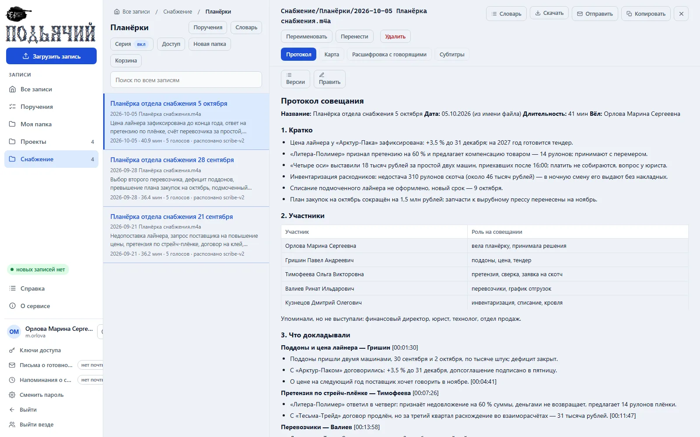

# Подьячий — протоколы совещаний из записей, на своём сервере

Сервис превращает записи совещаний, лекций и созвонов в расшифровку с разделением говорящих,
протокол с поручениями и карту протокола. Для организации или одного человека: ставится на свой
сервер или компьютер одним контейнером Docker. Люди работают через страницу в браузере, программы
и ИИ-клиенты — через API.

Открытый код, лицензия MIT. Сервис бесплатный; платить приходится только поставщику моделей —
за распознавание речи и текст протокола.



Совещание, люди и суммы на снимке вымышлены.

## Как это работает

1. Запись — видео или звук, до 4 ГБ — приходит через страницу, API или папку на диске.
2. Звук уходит на распознавание поставщику моделей (OpenRouter или RouterAI): в ответ — текст,
   время каждого слова и метка говорящего.
3. Языковая модель определяет тип записи и пишет протокол по шаблону этого типа; поручения
   совещания выписывают несколько моделей независимо — так их теряется меньше.
4. На странице записи — расшифровка, протокол и карта; метка времени у решения или задачи
   перематывает запись на нужное место.

Мощный сервер и видеокарта не нужны. Зато звук и текст записей уходят поставщику моделей и дальше —
владельцам моделей за границей ([ограничения](docs/features.md#ограничения)).

## Возможности

- **Протокол по шаблону** типа записи — совещание, лекция, созвон, постановка задачи; свои шаблоны.
- **Поручения** — реестр со сроками, отметкой «выполнено» и выгрузкой в CSV; незакрытые — в следующем протоколе.
- **Говорящие и словарь** — подписи голосов, участники и сокращения на папку и запись, словарь терминов.
- **Поиск и выгрузка** — поиск по протоколам и расшифровкам; DOCX, PDF, HTML; протокол на почту.
- **Два режима** — корпоративный (вход, папки с правами, вход через домен) и личный, без входа.
- **API и навык** для ИИ-клиентов — записи, поиск, поручения, загрузка, подписи говорящих, словари
  и управление сервисом; ключи, пароли, удаление и отправка протокола на почту — только на странице.
- **Расходы** по записям, папкам и людям — только администратору.

Подробно — **[docs/features.md](docs/features.md)**.

## Установка

Пошагово, с проверкой, сетью, HTTPS, почтой и резервной копией — **[install/README.md](install/README.md)**;
для себя, на своём компьютере и без входа — [install/personal.md](install/personal.md). Поручить
установку агенту (Claude Code, Cursor, Codex): «Установи Подьячий по
https://github.com/egordoronchenko/podyachiy/blob/v1.1.0/install/AI-INSTALL.md».

### Быстрый старт (образ)

Нужны Docker с плагином compose и [ключ поставщика моделей](install/README.md#1-что-это-и-что-нужно).
Выберите выпуск `vX.Y.Z` в [Releases](https://github.com/egordoronchenko/podyachiy/releases) и
замените `X.Y.Z` в командах; образ — `egordoronchenko/podyachiy:X.Y.Z` на
[Docker Hub](https://hub.docker.com/r/egordoronchenko/podyachiy). В пустой папке, Windows PowerShell:

```powershell
'compose.yml','.env.example','Caddyfile.example' | ForEach-Object { Invoke-WebRequest "https://raw.githubusercontent.com/egordoronchenko/podyachiy/vX.Y.Z/install/$_" -OutFile $_ -UseBasicParsing }
Copy-Item .env.example .env
```

Linux:

```bash
for f in compose.yml .env.example Caddyfile.example; do curl -fsSLO "https://raw.githubusercontent.com/egordoronchenko/podyachiy/vX.Y.Z/install/$f"; done
cp .env.example .env
```

`Caddyfile.example` нужен только для HTTPS. В `.env` впишите `OPENAI_API_KEY`, `ADMIN_PASSWORD` и
`IMAGE_TAG=X.Y.Z` ([обязательные строки](install/README.md#шаг-2-две-обязательные-строки-в-env);
для себя — [личный режим](install/personal.md#что-поменять-в-env)) и запустите `docker compose up -d`.

Откройте <http://localhost:8081>: логин `admin`, пароль из `.env`. Дальше —
[проверка](install/README.md#шаг-4-проверка), [доступ из сети](install/README.md#5-сеть-доступ-с-других-компьютеров),
[первый вход администратора](install/README.md#6-первый-вход-администратора); вторая установка на
той же машине — [со своими именем проекта и портом](install/README.md#вторая-установка-на-той-же-машине).

### Из исходников

```bash
git clone https://github.com/egordoronchenko/podyachiy.git
cd podyachiy
cp install/.env.example .env          # вписать OPENAI_API_KEY и ADMIN_PASSWORD
docker compose up -d --build
```

Тесты, устройство репозитория, сборка документации и образа — [docs/development.md](docs/development.md).

## Документация

| Что | Где |
|---|---|
| Возможности подробно: обработка записи, режимы, вход через домен, поставщики, ограничения | [docs/features.md](docs/features.md) |
| Установка и сопровождение: `.env`, сеть, HTTPS, почта, домен, резервная копия, обновление, сбои | [install/README.md](install/README.md), одним файлом — [site/podyachiy-install.html](site/podyachiy-install.html) |
| Установить для себя | [install/personal.md](install/personal.md) |
| Установка ИИ-агентом | [install/AI-INSTALL.md](install/AI-INSTALL.md) |
| Руководство пользователя со снимками экрана | [docs/guide/README.md](docs/guide/README.md), одним файлом — [site/podyachiy-guide.html](site/podyachiy-guide.html) |
| Справка внутри сервиса | меню «Справка» — [app/static/help.html](app/static/help.html) |
| API, навык для ИИ-клиентов, примеры запросов | [docs/integration.md](docs/integration.md) |
| Визитка и демонстрация на выдуманных записях — скачать и открыть с диска | [site/podyachiy.html](site/podyachiy.html), [site/podyachiy-demo.html](site/podyachiy-demo.html) |
| Разработка: устройство, тесты, сборка документации и образа, выпуск | [docs/development.md](docs/development.md) |
| Сообщить об ошибке, предложить правку | [CONTRIBUTING.md](CONTRIBUTING.md) |
| Уязвимости — письмом | [SECURITY.md](SECURITY.md) |
| Сторонние компоненты образа и их лицензии: FFmpeg, пакеты Debian, шрифты | [THIRD_PARTY.md](THIRD_PARTY.md) |
| Что изменилось по версиям | [CHANGELOG.md](CHANGELOG.md) |

## Лицензия

[MIT](LICENSE) © 2026 Доронченко Егор. Название «Подьячий» и логотип не покрываются лицензией MIT.
Сторонние компоненты образа — на своих лицензиях: [THIRD_PARTY.md](THIRD_PARTY.md). Сервис
распространяется «как есть», без гарантий и поддержки. Автор — почта <mazedastra@gmail.com>,
Telegram [@EgorDoronchenko](https://t.me/EgorDoronchenko).
