# «Подьячий»: руководство пользователя

Как из записи совещания получить протокол с поручениями и что с ним делать дальше. Читается
за пятнадцать минут; программировать и ставить ничего не нужно — всё делается в браузере.

---

## 1. Что это и для кого

«Подьячий» — сервис, который слушает запись совещания, лекции или созвона и пишет по ней три
вещи: **расшифровку** — кто что сказал и когда, **протокол** — решения, поручения по людям
со сроками, открытые вопросы, и **карту** — тот же протокол деревом. Запись — это видео или звук
файлом; сервис сам берёт из видео звук.

Кому он полезен:

- **Тому, кто ведёт совещания:** протокол готов через несколько минут после загрузки записи,
  его остаётся вычитать, а не писать.
- **Тому, кому поручают:** все поручения из всех протоколов собраны в один реестр — со сроками
  и отметкой «выполнено».
- **Руководителю:** видно, что решили и что не сделано к сроку, без пересмотра записей.
- **Тому, кого на совещании не было:** протокол читается за пять минут, а метка времени у каждого
  пункта открывает запись на нужном месте.

Сервис ставится на сервер организации, люди открывают его в браузере по внутреннему адресу.
Распознают речь и пишут протокол внешние модели: звук и текст записи уходят поставщику моделей.
Поэтому обработка каждой записи платная — платит организация, а право загружать записи выдаётся
отдельно от права читать.

> Протокол пишет языковая модель. Он экономит время, но не заменяет вычитку: что проверять глазами,
> написано в разделе 5.

---

## 2. От записи до протокола

### Войдите

Откройте адрес сервиса в браузере и введите логин и пароль. Их выдаёт администратор сервиса.
Учётной записи нет — нажмите на странице входа «Запросить доступ»: администратор рассмотрит заявку,
и вы получите ссылку, по которой сами зададите пароль. Если на странице входа написано «Входите
учётной записью домена», подойдут логин и пароль от рабочего компьютера.

Слева — меню: «Все записи», «Поручения», «Моя папка» и общие папки, которые вам открыли.
Записи лежат в папках, и права выдаются на папку:

| Право | Что можно |
|---|---|
| Чтение | видеть записи, протоколы и расшифровки, искать, смотреть поручения, скачивать протокол |
| Загрузка | ещё и загружать записи в папку |
| Администрирование | ещё и подписывать говорящих, пересобирать протокол, править словарь, отмечать поручения, переименовывать, переносить и удалять записи, отправлять протокол на почту, давать коллегам чтение и загрузку |

В личной папке («Моя папка») вы хозяин: её видите только вы и администратор сервиса.

### Загрузите запись

Откройте папку и нажмите **«Загрузить запись»** — или перетащите файл мышью в список записей.
Можно выбрать несколько файлов сразу.

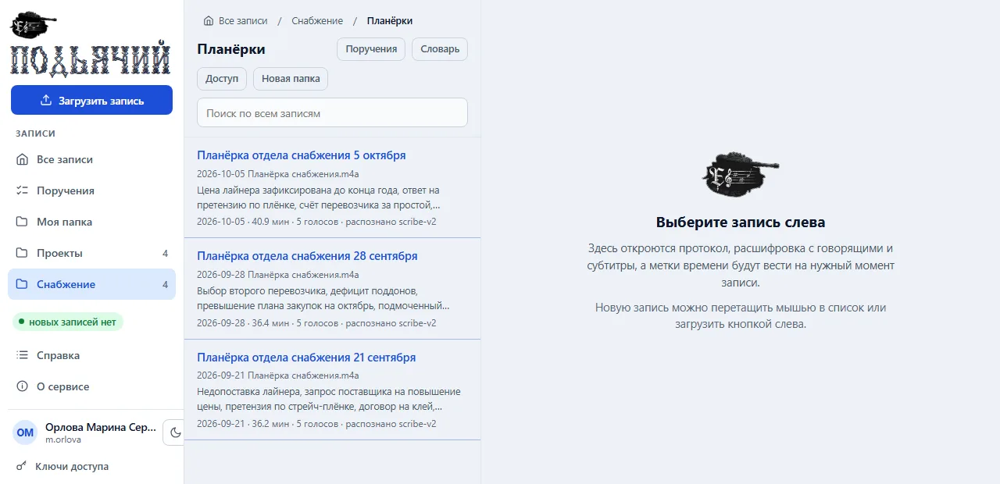

- Подходят видео (`mp4`, `mkv`, `mov`, `avi`, `webm` и другие) и звук (`mp3`, `wav`, `m4a`, `ogg`,
  `flac` и другие). Предел — 4 ГБ на файл, если администратор не задал другой.
- С телефона или из дома загружайте звук, а не видео: час записи в `mp3` — это 30–60 МБ вместо
  гигабайта, а результат тот же.
- Не закрывайте вкладку, пока идёт загрузка. Оборвалась связь — выберите тот же файл в той же
  папке ещё раз: загрузка продолжится с принятого места.
- Дата в названии файла — `Планёрка 05.10.2026.mp4` — попадёт в протокол как дата совещания.
- При загрузке можно сразу вписать, кто был на совещании: «Словарь записи» у строки загрузки.

Кнопки «Загрузить запись» нет — у вас нет права загрузки ни в одной папке. Кнопка есть, но
неактивна — под ней написано почему: откройте папку, куда вам можно загружать, или попросите
право загрузки у администратора папки.

### Дождитесь

Часовая запись обрабатывается пять–восемь минут, трёхчасовая лекция — до двадцати. Статус виден
в списке записей:

| Статус | Что значит |
|---|---|
| в очереди | перед этой записью обрабатываются другие |
| обрабатывается | под названием написан текущий шаг: распознавание, разбор, поручения, протокол |
| готово | есть протокол, расшифровка, субтитры и карта |
| нет протокола | речь распознана, протокол собрать не удалось; расшифровка доступна, сервис попробует ещё раз сам |
| нет звука | в файле пустая звуковая дорожка — проверьте запись в плеере |
| ошибка | причина написана под названием; при сбое связи сервис повторит сам |

Если в сервисе включена почта и она указана в вашей учётной записи, о готовности придёт письмо:
название, краткий итог и ссылка.

### Прочитайте протокол

Щёлкните по записи в списке — справа откроется протокол.

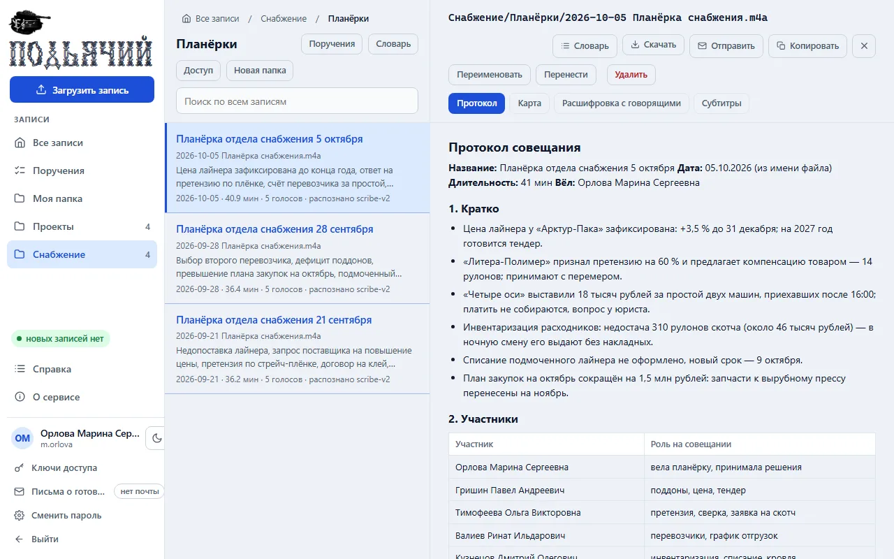

Сервис сам определяет, что это за запись, и пишет документ по своему шаблону:

| Тип записи | Что в протоколе |
|---|---|
| Совещание | кратко, участники, что докладывали, решения, задачи по людям со сроками, открытые вопросы, риски |
| Лекция | структура с метками времени, содержание по разделам, советы, вопросы слушателей, термины |
| Постановка задачи | что делаем и зачем, источники данных, что должно получиться, правила, открытые вопросы |
| Созвон с заказчиком | требования и пожелания, договорённости, задачи обеих сторон, открытые вопросы, риски |

У решений и задач стоит метка времени — `[00:31:23]`. Щелчок по ней включает запись с этого места
в плеере над текстом: так проверяют, что было сказано на самом деле.

### Расшифровка с говорящими

Вкладка **«Расшифровка с говорящими»** — полный текст по репликам: кто сказал и когда. Щелчок
по времени реплики включает звук с неё. Расшифровка не правится: это первоисточник, по которому
проверяют протокол. На вкладке «Субтитры» — файл `.srt` для плеера.

### Подпишите голоса

Сервис различает голоса, но не знает людей: в расшифровке они помечены `S1`, `S2`, `S3`. Имена
он угадывает по обращениям в разговоре, и такая подпись — «Иван (S1)» — может быть неверной.
Чтобы в протоколе стояли настоящие ФИО:

1. Откройте вкладку «Расшифровка с говорящими» и нажмите **«Говорящие»**.
2. Послушайте каждый голос кнопкой рядом с ним и впишите ФИО тем, кого узнали.
3. Нажмите **«Сохранить и пересобрать протокол»**.

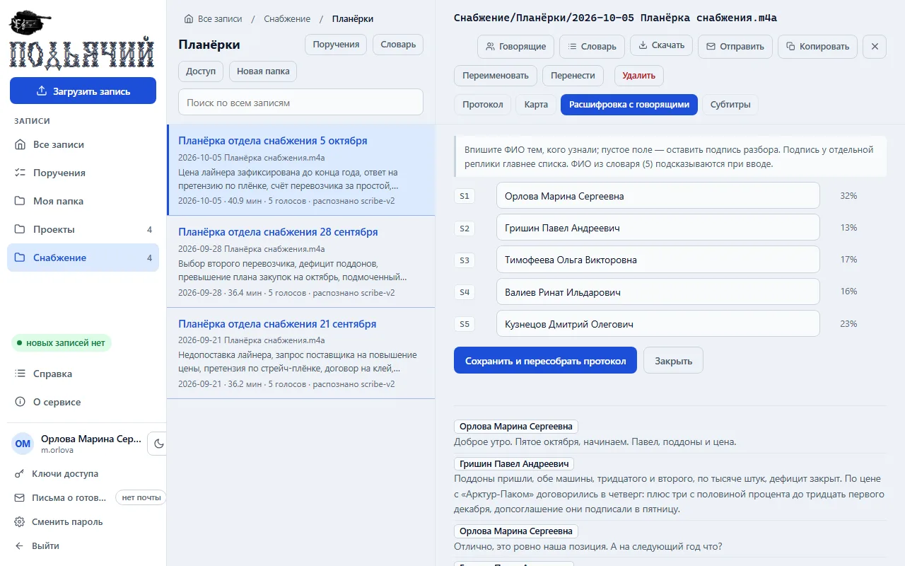

Пересобирается только текст протокола: речь заново не распознаётся, это три–пять минут. Подписи
сохраняются сразу, а пересборка платная — поэтому **подпишите всех сразу и пересоберите один раз**.
Вписывайте только тех, в ком уверены: неверное ФИО уйдёт в протокол вместе с поручениями этого
голоса. Подписывать может хозяин папки — владелец личной, администратор общей.

### Словарь: участники и сокращения

Распознавание пишет на слух: фамилия выходит в двух вариантах, название системы — набором букв.
Запишите один раз, кто бывает на ваших совещаниях и какие у вас сокращения, — и в протоколах
будут полные ФИО и правильные написания.

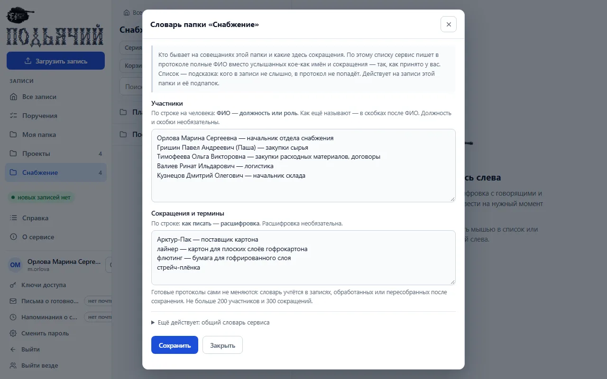

- **Словарь папки** — кнопка «Словарь» в открытой папке. Действует на записи этой папки
  и её подпапок.
- **Словарь записи** — кнопка «Словарь» в открытой записи: кто был именно на этом совещании.
  Он дополняет словарь папки.

В словаре два списка, по строке на запись: «ФИО — должность» и «сокращение — расшифровка».
Готовый список можно вставить целиком из приглашения на встречу или из таблицы. Словарь действует
на записи, обработанные после сохранения; готовый протокол меняется только после пересборки.
Читает словарь каждый, кому открыта папка, правит — её хозяин.

---

## 3. Найти и не потерять

### Поиск

Строка поиска на главной странице ищет сразу по всем протоколам и расшифровкам, которые вам
открыты. Введите несколько слов — найдутся записи, где есть все они. Под названием показаны куски
текста с найденными словами.

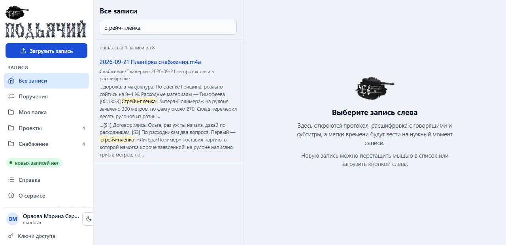

### Реестр поручений

Пункт меню **«Поручения»** собирает задачи из всех протоколов в одну таблицу: кто отвечает, что
сделать, срок, статус, с какого совещания. Название совещания открывает запись, а время в последней
колонке — запись на том месте, где поручение прозвучало.

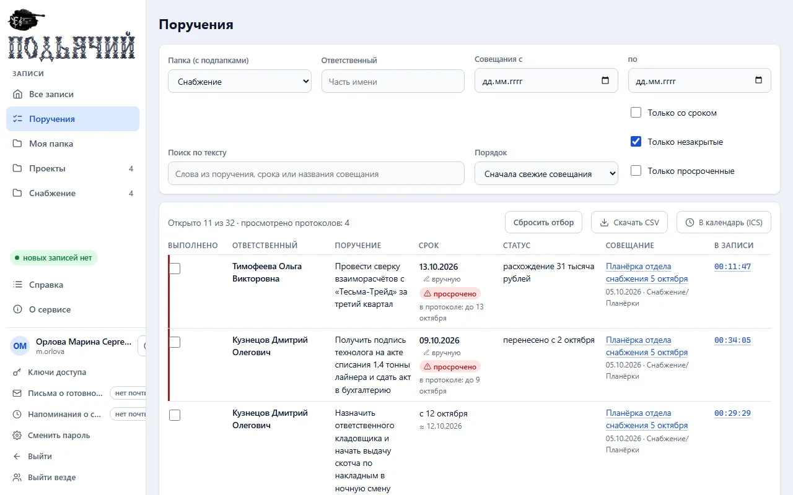

- **Отбор:** папка, ответственный (хватит части имени), даты совещаний, «только со сроком»,
  «только незакрытые», «только просроченные», слова из текста. Отбор остаётся в адресе страницы —
  ссылку можно сохранить или отправить коллеге.
- **«Скачать CSV»** — те же строки файлом для Excel.
- Кнопка «Поручения» в открытой папке показывает ту же таблицу только по этой папке.

В конце каждого нового протокола сервис сам дописывает раздел **«Поручения прошлого совещания»** —
незакрытые поручения предыдущей записи той же папки. Поэтому записи одной серии совещаний держите
в одной папке: следующее совещание можно начать с этого раздела.

### Отметка «выполнено» и срок

Статус в протоколе — то, что сказали на совещании. Что поручение выполнили потом, отмечает
человек: флажком в реестре или в разделе «Задачи» протокола. К отметке можно добавить комментарий;
рядом написано, кто и когда её поставил.

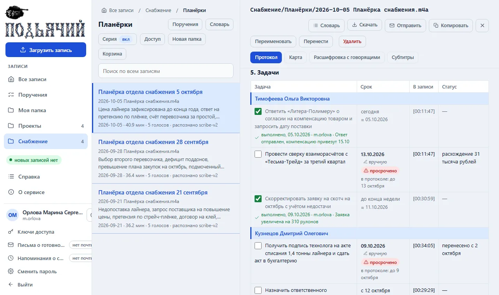

Срок в протоколе записан так, как прозвучал: «до конца недели», «после отпуска». Если его можно
пересчитать от дня совещания, рядом стоит дата со знаком «≈». Чтобы задать срок точно, щёлкните
по нему и выберите день: у даты появится пометка «вручную». Поручение с такой датой, не закрытое
в срок, помечается **«просрочено»**.

Ставить отметку и срок может хозяин папки, в которой лежит запись: владелец личной, администратор
общей, администратор сервиса. Остальным они видны, но не меняются.

### Карта записи

Вкладка **«Карта»** — между «Протоколом» и «Расшифровкой» — открывает протокол деревом на отдельной
странице: разделы, темы, задачи по людям. Ветки сворачиваются, есть поиск; щелчок по узлу показывает
полный текст пункта и метки времени. Виды на этой странице идут в том же порядке: «Протокол», «Карта»,
«Расшифровка». Вернуться к записи — кнопка **«← К записи»** слева в шапке или «назад» в браузере.

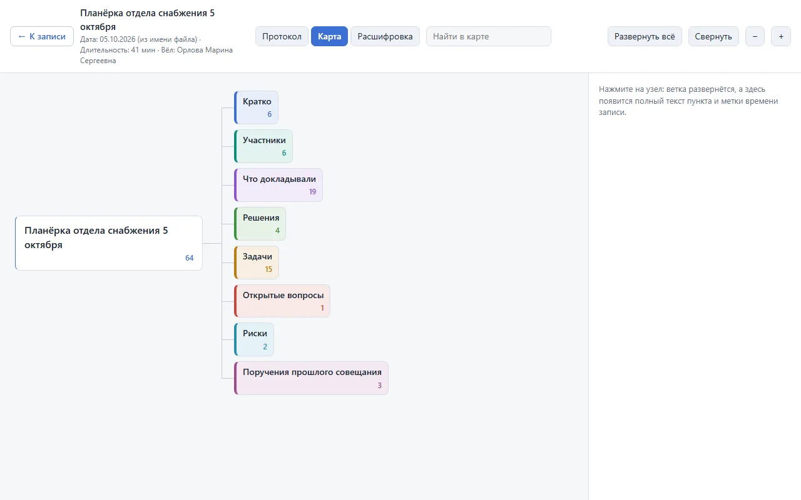

---

## 4. Поделиться

### Скачать DOCX или PDF

Кнопка **«Скачать»** в открытой записи:

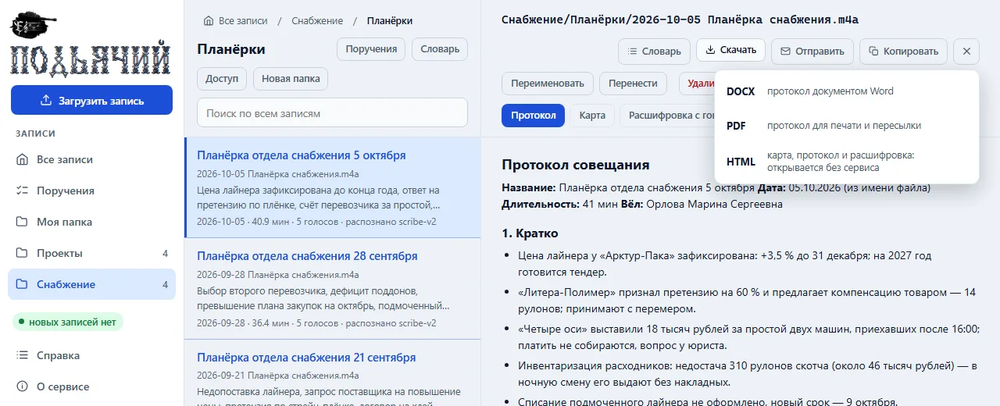

- **DOCX** — протокол документом Word: править и вставлять в свои документы.
- **PDF** — печатать и пересылать.
- **HTML** — протокол, карта и расшифровка одним файлом: открывается в любом браузере без сервиса
  и без интернета. Звука в файле нет.

В DOCX и PDF — название записи, дата, длительность, разделы протокола и таблицы; отметки
«выполнено» и сроки, заданные вручную, стоят в таблице задач. Кнопка «Копировать» кладёт текст
открытой вкладки в буфер обмена.

### Отправить протокол

Кнопка **«Отправить»** шлёт протокол на почту прямо из записи: отметьте коллег или впишите адреса,
выберите вложение — PDF, DOCX или только ссылку — и при желании допишите пару слов.

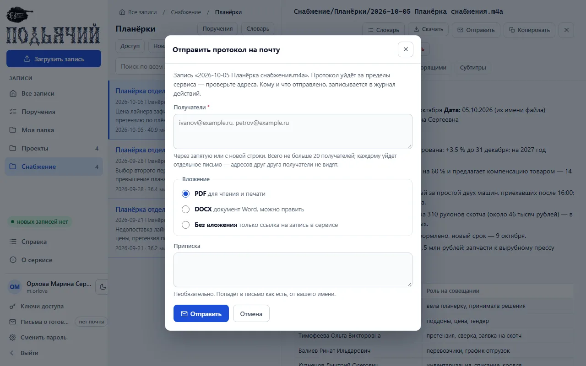

Каждому получателю уходит отдельное письмо — адресов друг друга они не видят. За раз — не больше
20 получателей, в час — не больше 10 отправок. Ссылка из письма откроется только у того, у кого
есть учётная запись и доступ к папке. Кнопка есть у хозяина папки и только если в сервисе включена
почта; администратор может разрешить только адреса почты организации.

### Дать доступ коллеге

В папке, где вы администратор, кнопка **«Доступ»** открывает таблицу: у каждого коллеги выбираете
чтение и, отдельно, загрузку — «нет», «только эта папка» или «папка с подпапками».

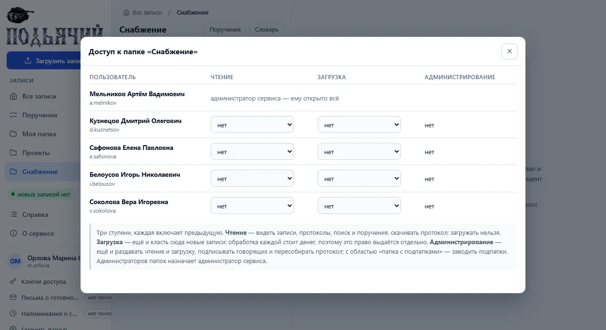

Чтение загружать не разрешает: обработка записи платная, поэтому загрузку выдают отдельно.
Администраторов папок назначает администратор сервиса. Ссылка из адресной строки открывает ту же
запись — но только у того, кому папка открыта.

### Переименовать, перенести, удалить

Кнопки под названием открытой записи — у хозяина папки. При переименовании и переносе вместе
с записью переезжают протокол, расшифровка, отметки у поручений и словарь; заново запись не
обрабатывается. Удалённая запись 30 дней лежит в корзине на сервере: за это время её может вернуть
администратор сервиса. Переименовывать и перекладывать файлы на диске мимо страницы не нужно —
сервис примет их за новые записи.

### Ключ доступа и ИИ-клиент

Cursor, Claude Code, Codex и другие ИИ-клиенты с терминалом могут сами находить ваши протоколы,
собирать поручения, загружать записи и подписывать говорящих. Клиент ходит в сервис от вашего
имени и видит то же, что вы.

1. В меню под своим именем откройте **«Ключи доступа»**, назовите ключ, выберите срок и нажмите
   «Выпустить ключ». Ключ показывается один раз.
2. В «Справке», раздел «Интеграция с ИИ», скопируйте текст для чата клиента и вставьте его
   в клиент: он сам поставит навык — короткую инструкцию, как обращаться к сервису.
3. Впишите ключ в файл `.podyachiy` в своей домашней папке — не в чат.
4. Спросите клиента: «Подьячий: кто я?»

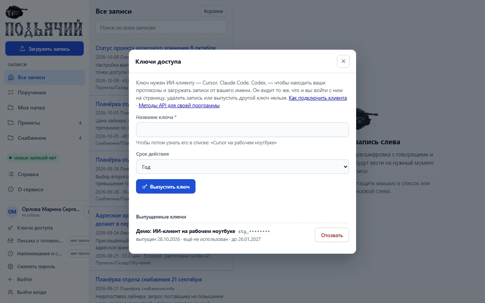

Дальше просите обычными словами: «найди протокол вчерашней планёрки и перескажи решения», «какие
на мне поручения с начала месяца?», «загрузи эту запись в папку Проекты и скажи, когда будет готов
протокол». Удалить запись, отправить протокол на почту или выпустить другой ключ клиент не может —
это только на странице. Потеряли ноутбук — отзовите ключ в том же окне: пароль при этом
не меняется.

Клиент должен работать на компьютере, с которого открывается сервис. Для своих программ есть
описание методов — раздел «API» в сервисе.

---

## 5. Чему верить и что проверять глазами

Протокол пишет языковая модель по автоматической расшифровке.

- **Поручения иногда теряются.** Модель может пропустить часть поручений. Важное
  совещание пробегите по расшифровке.
- **Кто что сказал — самое слабое место.** Если два голоса похожи или людей много, реплики
  путаются, а с ними и ответственные. Пометка «многолюдно» у записи значит, что голосов больше
  пяти, «метки ненадёжны» — что заметная часть слов осталась без голоса.
- **Фамилии и названия коверкаются.** Лечится словарём папки и подписью говорящих.
- **Цифры и сроки сверяйте по записи.** Для этого у каждого пункта стоит метка времени.
- **Раздел «Комментарии» в конце протокола** перечисляет, какие слова исправлены и что разобрать
  не удалось. Начинать проверку удобно с него.
- **Пометка «шаблон выбран неуверенно»** — сервис сомневается, совещание это или лекция. Если тип
  определён неверно, администратор перезапустит запись с нужным шаблоном.

Короткий порядок вычитки: комментарии в конце → участники и подписи голосов → задачи и сроки
по меткам времени → решения.

---

## 6. Администратору

Блок **«Управление»** в меню виден только администратору сервиса. В нём пять разделов.

| Раздел | Что в нём |
|---|---|
| Обработка | модель распознавания и поставщики, кнопка «Проверить ключ», очередь, история обработки, ручной запуск, журнал работы |
| Папки и доступ | общие папки, подпапки и кому они открыты |
| Пользователи | учётные записи, заявки на доступ, ключи доступа всех пользователей, почта, вход через домен |
| Расходы | сколько потрачено у поставщика: по времени, папкам, людям, записям; отчёт целиком файлом Excel, CSV или в PDF; журнал действий |
| Настройки | шаблоны протоколов и свои типы записей, общий словарь, логотип и название организации |

С чего начать после установки:

1. **Проверьте ключ поставщика:** «Обработка» → «Проверить ключ». Запрос бесплатный.
2. **Заведите общие папки** в «Папках и доступе» — по отделам или сериям совещаний.
3. **Заведите людей** в «Пользователях» или принимайте заявки на доступ. Галочка «Загрузка
   в личную папку» разрешает человеку загружать записи себе.
4. **Раздайте права на папки:** чтение, загрузка, администрирование — «только эта папка» или
   «папка с подпапками». Администратор папки дальше раздаёт чтение и загрузку сам.
5. **Впишите общий словарь** в «Настройках»: названия систем и термины организации.

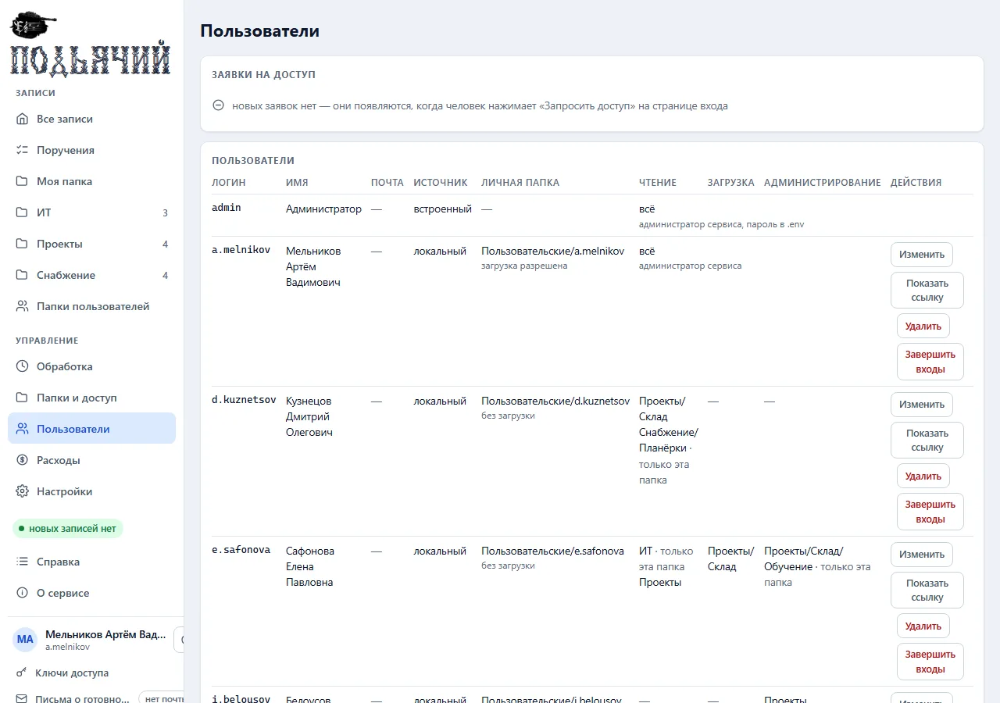

Ручной запуск в «Обработке» повторяет запись после ошибки или собирает протокол заново по другому
шаблону — без повторного распознавания. «Расходы» показывают траты отдельно в рублях и в долларах,
без пересчёта; журнал действий внизу раздела отвечает, кто и когда выдал право, удалил запись или
отправил протокол. Расходы видит только администратор сервиса: остальным пользователям суммы
не показываются.

Кнопки **«Скачать отчёт целиком»** отдают весь отчёт по выбранным периоду и шагу, а не одну открытую
вкладку: **Excel** — книга с листом «Сводка» и листами по разрезам (периоды, папки, пользователи,
записи, этапы и модели, поставщики, журнал прогонов); **CSV** — те же таблицы подряд в одном файле;
**PDF (печать)** — печать страницы со всеми разрезами подряд.

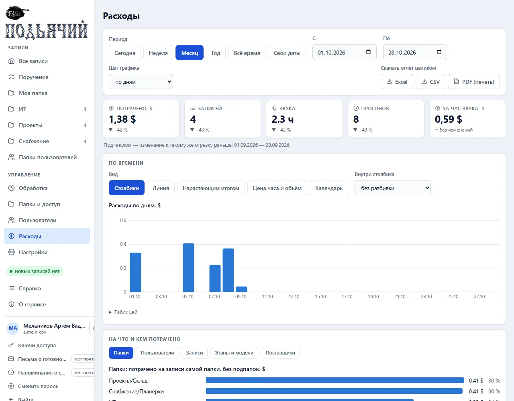

Установка, файл настроек, сеть, HTTPS, почта, вход через домен, резервная копия и обновление —
в [инструкции по установке](../../install/README.md). В сервисе она открывается из раздела
«Администратору» справки.

---

## 7. Если что-то не так

| Что видно | Что делать |
|---|---|
| Нет кнопки «Загрузить запись» | у вас нет права загрузки — попросите его у администратора папки или сервиса |
| Запись долго «обрабатывается» | часовая запись — пять–восемь минут; перед вашей может быть очередь |
| «Нет звука» | откройте файл в плеере: если звука нет и там, нужна другая копия записи |
| В протоколе чужая фамилия | откройте «Говорящие», исправьте подпись и пересоберите протокол |
| Термин записан с ошибкой | впишите его в словарь папки или записи и пересоберите протокол |
| После пересборки пропала отметка «выполнено» | формулировка поручения сильно изменилась — поставьте отметку заново |
| Не пришло письмо о готовности | проверьте «Спам» и что в вашей учётной записи указана почта |
| Страница не открывается | сервис остановлен — обратитесь к администратору |

Полная справка — пункт «Справка» в меню сервиса.
